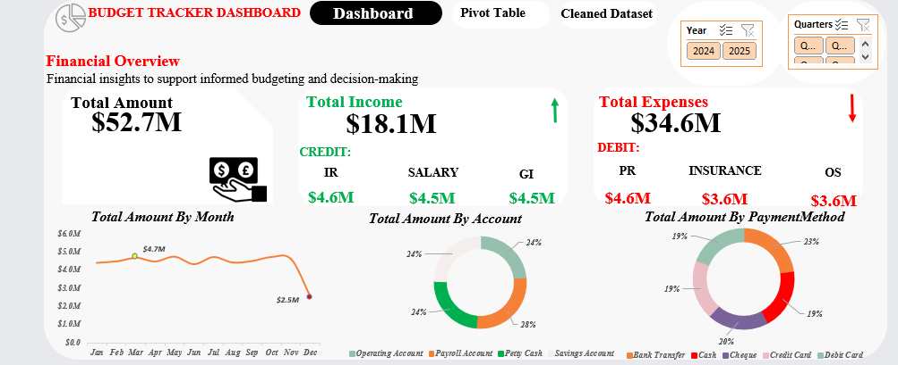

# Budget Tracking and Financial Performance Analysis Using Microsoft Excel

## Project Overview

This project focuses on analyzing an organization's financial transactions to evaluate income, expenses, transaction trends, account activity, and payment methods.

The objective was to transform a dataset containing inconsistent formatting and duplicate records into a structured financial reporting dashboard that supports informed budgeting and financial decision-making.

**Microsoft Excel** was used for data cleaning, transformation, PivotTable analysis, and interactive dashboard development.

The analysis identified a significant gap between income and expenses, highlighting the importance of financial monitoring, expenditure control, and sustainable financial planning.

## Dashboard Preview

## Business Objectives

The analysis was designed to answer the following questions:

1. What is the total income and expenditure recorded by the organization?
2. Does the organization generate sufficient income to cover its expenses?
3. How does transaction activity vary across months and years?
4. Which income and expense categories contribute the most?
5. Which accounts record the highest transaction values?
6. How are transactions distributed across payment methods?
7. What financial management improvements can be recommended?

## Tools and Skills

- **Microsoft Excel:** Data cleaning, transformation, analysis, and dashboard development.
- **Excel Functions:** `PROPER`, `TRIM`, `CLEAN`, `CONCAT`, and `TEXT`.
- **Text to Columns:** Separating inconsistent transaction amount formats.
- **Numeric Conversion:** Converting numbers stored as text into valid numeric values.
- **PivotTables:** Summarizing financial transactions across multiple dimensions.
- **PivotCharts and Slicers:** Building interactive visualizations with year and quarter filters.

## Data Cleaning and Preparation

The original dataset required several cleaning and transformation steps before it could be used for financial analysis.

### 1. Duplicate Removal

Identified and removed duplicate records to prevent repeated transactions from affecting financial calculations.

### 2. Text Standardization

Used Excel functions including `PROPER`, `TRIM`, and `CLEAN` to correct inconsistent capitalization, remove unnecessary spaces, and eliminate unwanted non-printable characters.

### 3. Amount Column Cleaning

Identified inconsistent amount formats, including numeric values stored as text and values containing currency symbols and annotations such as `(Approx.)`.

Used **Text to Columns** to separate the currency symbols, numeric amounts, and additional annotations. Unnecessary components were removed while retaining the relevant transaction amounts.

### 4. Amount Consolidation and Numeric Conversion

Used `CONCAT` to combine the relevant amount components into a consistent column.

Converted the resulting text values into actual numeric values before creating PivotTables and performing financial calculations.

### 5. Date Transformation

Used Excel's `TEXT` function to extract weekday information from transaction dates and prepared separate day, month, and year fields to support time-based analysis.

For example:

`=TEXT(A2,"ddd")`

### 6. Data Preparation for Analysis

The cleaned dataset was used to create PivotTables and develop an interactive financial dashboard.

The workbook retains the original dataset alongside the cleaned dataset to support transparency and comparison.

## Key Performance Indicators

| Metric | Value |
|---|---:|
| Total Transaction Value | $52.7M |
| Total Income | $18.1M |
| Total Expenses | $34.6M |
| Net Financial Result | -$16.5M |
| Income-to-Expense Coverage | Approximately 52.3% |

**Important:** Total transaction value represents the combined value of recorded income and expenses. It does not represent revenue or the organization's net financial position.

## Key Findings and Business Insights

### 1. Income and Expenditure Performance

The organization recorded approximately **$18.1 million in income** and **$34.6 million in expenses**, resulting in a **net deficit of $16.5 million**.

This means the organization spent approximately **$1.91 for every $1 earned**.

Income covered only approximately **52.3% of total expenses**, highlighting a significant financial gap.

**Recommendation:** Prioritize expenditure management, strengthen income-generating activities, and implement regular budget-versus-actual reviews. Management should also investigate how the deficit is financed, including whether reserves or other funding sources are being used.

### 2. Monthly Transaction Trends

The monthly analysis shows relatively stable transaction values for much of the reporting period, generally ranging between approximately **$4.3M and $4.7M**.

March, May, July, and October recorded approximately **$4.7M**, while December declined to approximately **$2.5M**.

This indicates a notable reduction in recorded transaction activity toward the end of the year.

**Recommendation:** Investigate the December decline to determine whether it reflects seasonal activity, incomplete records, or changes in transaction timing. Monthly transaction totals should also be reconciled with the overall dashboard KPI before the figures are used for formal reporting.

### 3. Income and Expense Categories

Investment Return generated approximately **$4.6M**, making it the largest reported income category. Grant Income and Salary contributed approximately **$4.5M each**, while Consulting Income contributed approximately **$4.4M**.

Major expense categories included:

- Payroll — approximately $3.7M
- Insurance — approximately $3.6M
- Office Supplies — approximately $3.6M
- Marketing — approximately $3.5M
- Professional Fees — approximately $3.5M

**Recommendation:** Strengthen income diversification while reviewing major expense categories for potential cost savings, unnecessary expenditure, and improved budget allocation.

### 4. Account-Level Transaction Analysis

The Payroll Account recorded the highest transaction value at approximately **$14.7M**, followed by:

- Savings Account — $12.9M
- Petty Cash — $12.6M
- Operating Account — $12.5M

These figures represent transaction values rather than confirmed account balances.

**Recommendation:** Implement regular account reconciliations, establish appropriate spending limits, and strengthen transaction approval procedures. Petty cash activity should receive particular attention to improve accountability.

### 5. Payment Method Analysis

Bank Transfer recorded the highest transaction value at approximately **$12.1M**, followed by Cheque at **$10.3M**, Cash at **$10.2M**, Credit Card at **$10.1M**, and Debit Card at **$10.0M**.

Transaction values were relatively evenly distributed across payment methods.

**Recommendation:** Strengthen financial controls across all payment methods through accurate documentation, regular reconciliation, approval procedures, and secure payment practices.

### 6. Year-on-Year Transaction Analysis

The analysis recorded approximately **$27.3M in 2024**, compared with **$25.3M in 2025**.

This represents a decrease of approximately **$2.0M**, or **7.3%**, in total recorded transaction value.

However, this change does not necessarily represent a decline in income because the figures combine income and expenditure.

**Recommendation:** Compare annual income, expenses, and net financial results separately to determine whether financial performance improved or deteriorated between the two years.

## Overall Business Recommendations

1. **Improve financial sustainability:** Address the gap between income and expenses through expenditure reviews and stronger financial planning.

2. **Strengthen budgetary controls:** Establish departmental budgets and monitor actual spending against approved allocations.

3. **Diversify income sources:** Explore opportunities to strengthen consulting income, grants, and investment returns.

4. **Improve cash flow planning:** Develop rolling cash flow forecasts to anticipate financial shortfalls.

5. **Strengthen transaction monitoring:** Conduct regular account reconciliations and maintain appropriate payment authorization procedures.

6. **Improve financial reporting:** Separate income, expenses, and net financial results in monthly and annual reporting to support more accurate performance evaluation.

## Project Limitations

- The total transaction value combines income and expenses and should not be interpreted as revenue.
- Account-level transaction totals do not necessarily represent account balances.
- Monthly and annual transaction totals should be reconciled with the underlying dataset before formal financial reporting.
- Changes in transaction values do not independently establish changes in financial performance.
- The analysis identifies a recorded deficit but does not establish how that deficit was financed.
- Further analysis of opening balances, closing balances, liabilities, and cash flows would provide a more complete assessment of the organization's financial position.

## Project Files

- `BUDGET TRACKER.xlsx` — Excel workbook containing the original dataset, cleaned dataset, PivotTables, dashboard, and insights.
- `README.md` — Project documentation.
- `images/dashboard.png` — Dashboard screenshot.

## Conclusion

This project demonstrates how Microsoft Excel can be used to transform inconsistent financial transaction data into structured analysis and an interactive dashboard.

The findings highlight a significant difference between recorded income and expenditure, alongside important patterns in transaction activity, income and expense categories, accounts, and payment methods.

The project showcases practical skills in **data cleaning, financial analysis, PivotTables, dashboard development, data storytelling, and business recommendations**.
